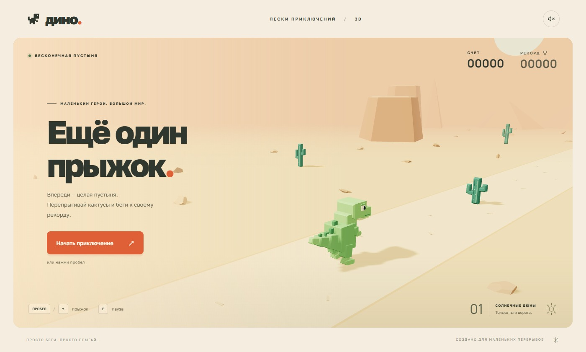
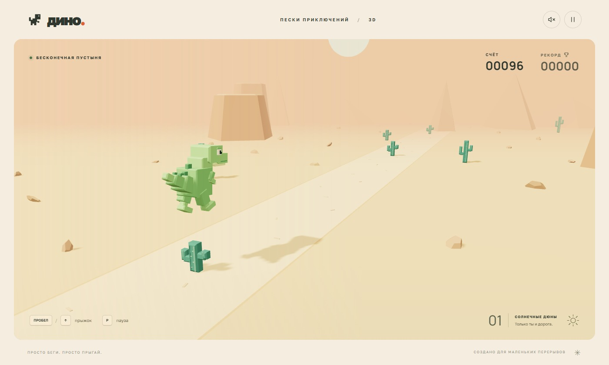

# Dino Dunes — Пески приключений

Маленький динозавр бежит через солнечные дюны. На пути растут кактусы, а скорость постепенно увеличивается. Чем дальше удаётся пробежать, тем выше счёт. Личный рекорд сохраняется в браузере.

**[Играть в Dino Dunes в браузере](https://zxclunexxx.github.io/dino-dunes/)**



## Как играть

Нажмите «Начать приключение» или пробел. Динозавр побежит сам. Чтобы уклониться от кактуса, прыгайте перед препятствием.

| Действие | Управление |
| --- | --- |
| Прыгнуть | Пробел, ↑, W или касание игрового поля |
| Поставить на паузу или продолжить | P, Esc или кнопка паузы вверху экрана |
| Начать новый забег после столкновения | Пробел или «Ещё раз» |



## Запуск из исходников

Игра написана на JavaScript и Three.js. Для запуска в браузере с поддержкой WebGL откройте терминал в папке проекта и выполните команду.

```sh
python -m http.server 8000 --bind 127.0.0.1
```

Откройте в браузере `http://127.0.0.1:8000`. Для проверки физики прыжка и столкновений выполните `node check-dino-physics.mjs`.

Для игры без локального сервера скачайте файл `dino-3d.html` и откройте его в браузере.
